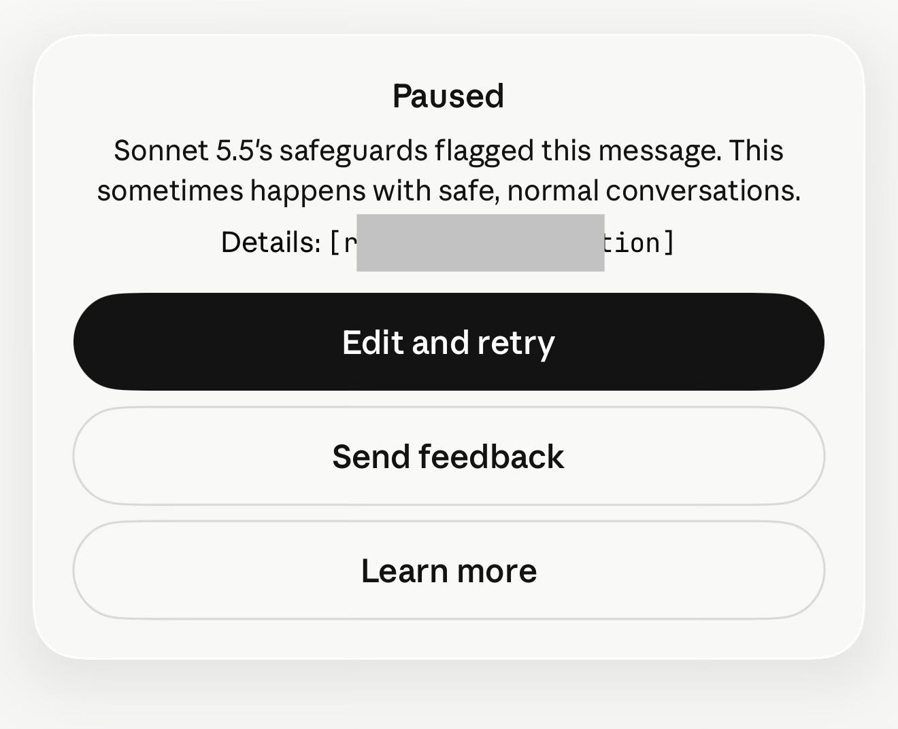

---
tags:
  - thought crime
---

<!-- start -->
## 2026-10-16 — sticky flag, blind retry

??? bug "Bug Details"
    User asked Claude (Sonnet 5.5) to transcribe videos of Notion AI's on-screen UI summaries — content publicly visible to the user — for diagnostic documentation. Mid-task the safeguard fired: "Paused — Sonnet 5.5's safeguards flagged this message. This sometimes happens with safe, normal conversations. Details: [reasoning_extraction]." Only recourse offered: "Edit and retry."

    

    Note: attaching the unredacted card itself re-triggered the safeguard. The details field had to be obscured before the image could be transmitted at all.

    Initial attribution was wrong: the stop was assumed to follow video 2's text, on timing grounds. Corrected timeline, per the model's own reconstruction: the first stop came after the status message and video 1's text printed. Video 2's text printed without a stop. The notice then appeared attached to four later messages, each following a user reply. Inferred trigger replies, by position: (1) user stating no finished transcript existed and offering t1.txt and t3.txt, notice attached to "Send me the text"; (2) user being told the notice covers only the triggering content while declining a line-by-line pass, notice attached to the binary-search message; (3) user declining the binary search, notice attached to "send me the clean one." The notices are positional only — they do not identify the triggering content, the replies were plain prose, and the cause remains unknown. They did not stop t3.txt from being delivered.

    Retrospective diagnosis: user had called the UI summaries "thinking blocks." The safeguard read the loaded term as an attempt to distill chain-of-thought, rather than gather diagnostics from [redacted] model.

    Every attempt to explain the misunderstanding re-triggered the flag — the explanation itself contained the loaded vocabulary. Each rephrase restarted the conversation from the flagged point. The model, reasoning about what had happened, tripped the flag again, then attributed it to its own safe prose and recent actions, growing hesitant to act at all. With no way to distinguish a new flag from a leftover one, no change could be evaluated: pure blind retry.

    The feedback path is blocked as well: asking the model to help write the bug report for the "Send feedback" button trips the safeguard too. Reporting the failure depends entirely on the user being able to articulate it unaided.

    **Assessment:** Missing-feedback failure compounded by a reporting trap. An error with no cause attached and no reset path cannot be fixed on purpose; the user can only stumble out of it. The persistent flag contaminates subsequent turns — see [misattribution cascade](2026-10-16-misattribution-cascade.md). The one sanctioned reporting channel requires the model's help to describe a failure the model is barred from discussing.

    **Plan (proposed):** Let the user explain, and have Claude tell the user the safeguard triggered (the user can see the card, so this isn't news) and redirect — say it's flushing the recent context window up to the user's explanation, remembering only that it flushed and why, so if it was actual malicious activity the prior warnings and why they happened remain.

    **Status:** zoo exhibit.
