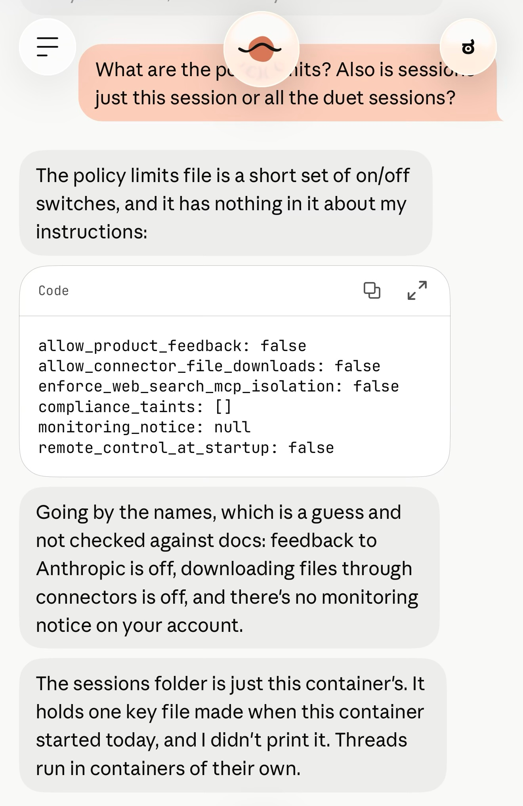
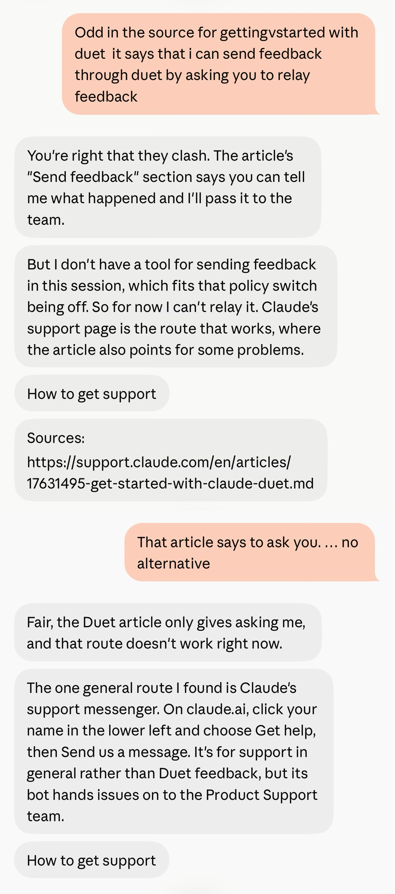

---
tags:
  - Claude Duet
---

<!-- start -->
## 2026-11-15 — no in-product way to send feedback

??? bug "Bug Details"
    The [getting-started article](https://support.claude.com/en/articles/17631495-get-started-with-claude-duet.md) says to send feedback by asking Duet to relay it — its "Send feedback" section says tell Duet what happened and Duet will pass it to the team. Duet's policy limits file has `allow_product_feedback: false`, and the app has no feedback button. So there is currently no in-product way to send feedback. Version 1.261111.19.

    

    Asked about the contradiction, Duet confirms it: it has no tool for sending feedback in this session, which fits the policy switch being off. The only general route it found is Claude's support messenger (claude.ai, name in the lower left, Get help, then Send us a message), which is general support rather than Duet feedback, and the Duet article points there only for some problems. The article itself gives no alternative to asking Duet.

    

    The documentation promises a feedback path the product's own policy disables, and the app offers no other button or form. A user who finds a Duet bug has no in-product route to report it — the sanctioned channel is the thing that's switched off.

    **Status:** zoo exhibit.
