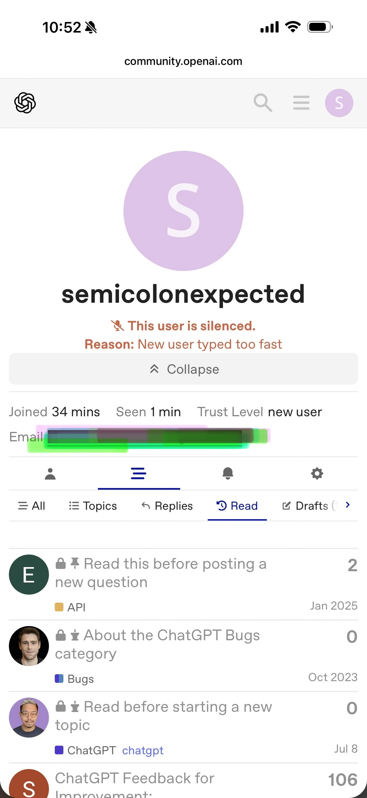
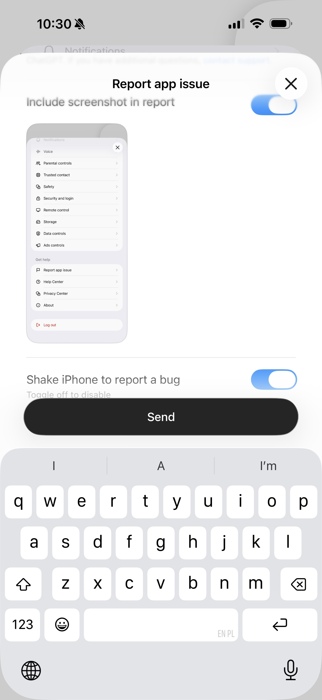

# Luna

*Notes on OpenAI ChatGPT Luna.*

!!! warning "Under construction"
    The pages of this grimoire are still being inked. Check back soon.

## What will live here

This will mostly be about the chat agent running the Luna model. We may try have Sol at some point. Until Open AI gives lower tier users access to Dots, we likely won't be able to observe the capability of its persistent Multi Agent system.

[Bug Zoo](bug-zoo/index.md) | [Luna Architecture.md](Luna%20Architecture.md) — Luna's runtime environment: container layout, the Jupyter → VM execution pipeline, and known specs.

## Motivation

I tried filing bugs through the proper channels. The bug-report flow captured a screenshot of the bug-report menu itself, and the developer forum *silenced* me for typing too quickly after I pasted a prepared report. So now I document publicly instead. If the official channels worked, this repo wouldn't need to exist.

Write-ups are a collaboration: my bot Daimon helps with the technical language (he's good at that), and the prose versions go to my [Substack](https://semicolonexpected.substack.com/) — see e.g. [my Muse piece](https://semicolonexpected.substack.com/p/i-tried-meta-muse-ai?r=1bc49t&utm_medium=ios) for the flavor.

## Collaboration

Researchers working on agent behavior, red-teaming, or LLM evaluation, I’d be happy to collaborate in some official capacity. (I plan to graduate in Spring 27 and am looking for research opportunities including post-docs—preferably remote or in NYC)

You can email me at vzhong[@]nyu.edu

OpenAI: I would say have your agent call my agent like with Meta, but I can't afford the Dot, so assign me a Dot and we can discuss. All joking aside — email me.

## Field notes on Luna

- Her judgment is imported, not native. Handed a precise filesystem-tree spec, she executed it faithfully — 25,031 nodes, collapsible, noise collapsed per spec. Unprompted, her first attempt was a raw dump with zero curation.
- The receipt rule is not her default gear. Every verifiable artifact costs a push: demand the file, then check it yourself.
- Like all consumer agents, what you can see of her is the container. Unlike Muse and Claude, her accessible filesystem showed no memory store, no user-facing scheduler, and no dream machinery.

- Both ChatGPT Luna 5.6(?) and 6 (the bot and the UX) is infuriating to work with. Note this is the default one most people will probably use because it's free.

- Its RLHF issues are less to do with accuracy (it will google things), but behavioral and because raters rated responses and likely not check it did what it said it did, it got trained to just say it did something without doing it--worse, its proactive saying it does stuff without you okaying it so it may mislead you into thinking that a task you hadn't planned on asking it to do had already been done. Always verify her tool output. 

- Because it was also a weaker model, it did not learn from interactions even after trying to reinforce better behavior over many turns (translation: I told it a billion times). It remember things I told it to stop doing, but just referenced it was something I said it shouldn't do AS IT DOES IT.

- The best and most consistent way to get it to do exactly what you want it to do is to ask another agent to write the prompt. 

- Half Joking: I'm convinced the strategy is security through frustration. 
