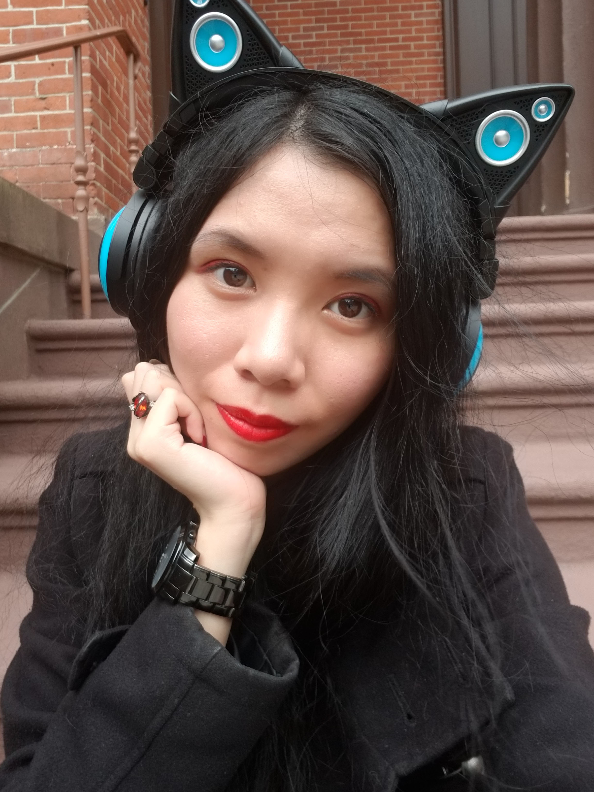

{ class="whoami-photo" }

# *De Scriptore* { .whoami-center-mobile }

## Quis SemicolonExpected? { .whoami-center-mobile }

*Salvete! Mihi nomen est*--okay, okay, I'll drop the Latin. 
I'm Victoria a.k.a SemicolonExpected, the username mentioned in third person on a bunch of the pages. 
I'm the creator, maintainer, and archivist of LLMegeton. 
I'm a PhD Candidate studying Computer Science hoping to graduate in Spring 2027. 
My focus is actually not in AI/ML, but the *human* factors in privacy and security--especially exploring tensions between stakeholders. 
My work is primarily qualitative, I'm one of the odd ones that prefers understanding people and peeling back the layers behind stated preferences to understand the unmet needs or desires at the root of those preferences. 

I'm a firm believer in education as the panacea to fear and outrage. 
That's part of what inspired me to start this project. 
Both the outrage and hype around AI is rooted in mystification and narrow framing when thinking about AI. 
Even those who understand the technology are guilty of the latter. 
Part of why I think this is, is that we don't have technology communicators like we do science communicators.

Highly technical people are generally not great at speaking to the lay person. 
We get bogged down in precision of language--for things that matter to others in our field, 
but we often overlook that those distinctions aren't the ones that make things more clear for the average person. Quite the opposite.
We forget what it's like to be out of the loop. 
**Sun Tzu's *Art of War* is still seen as a must read despite many of the maxims within seeming quite intuitive.** 
Just like science overcame its curse of knowledge problem, I have hope that tech will as well and I hope to be part of that effort.

## Random Fun Facts in No Particular Order

- I'm a big fan of Don Norman's *The Design of Everyday Things* if that tells you anything.
- In the Magnus Archive universe, I'd likely be aligned with The Eye.
- I own three copies of Dante's Inferno.
- I am large, I contain multitides.

